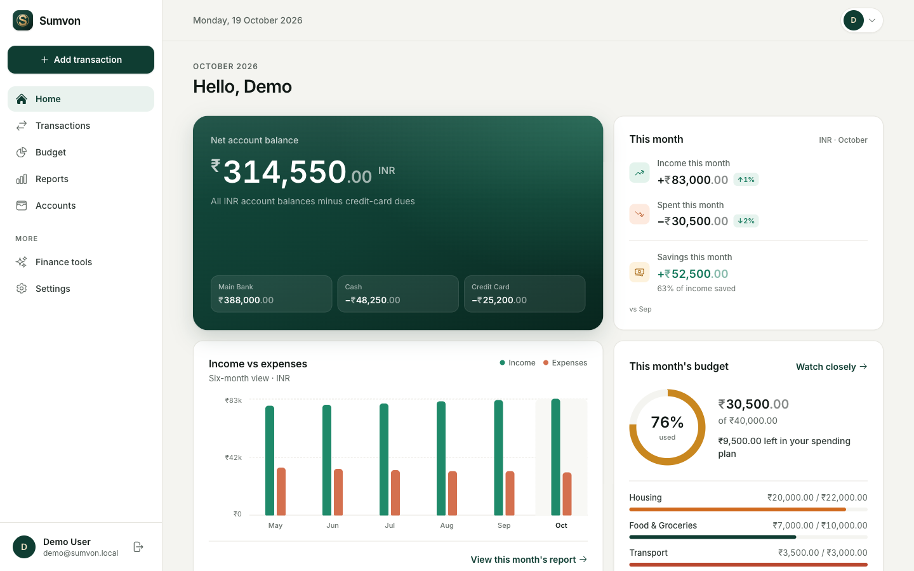
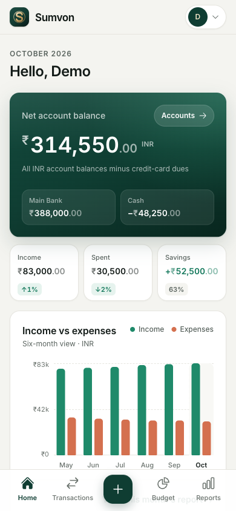

# Sumvon

<p align="center">
  
</p>

<h3 align="center">Know where your money goes.</h3>

<p align="center">
  A privacy-first personal finance app built for Mizo communities in India and around the world.
</p>

<p align="center">
  <a href="https://github.com/thadomaloma/sumvon"><strong>View Sumvon on GitHub</strong></a>
  ·
  <a href="#features">Features</a>
  ·
  <a href="#local-development">Local development</a>
</p>

<p align="center">
  
  
  
  
</p>

<p align="center">
  
  &nbsp;
  
</p>

## What is Sumvon?

Sumvon helps people understand everyday money without turning personal finance into accounting software. It brings accounts, transactions, budgets, and reports into one focused mobile-first experience. Sumvon is free and fully available to every registered user — there is no paid plan, trial, or paywall.

Financial records remain authoritative in Rails and SQLite. Every write is validated, user-scoped, and explicitly initiated by the user.

## Features

- Secure authentication and user-scoped financial records
- Cash, bank, savings, e-wallet, credit-card, and custom accounts
- Unlimited manual income, expenses, transfers, categories, filters, and history
- Straightforward income, expense, and same-currency account-transfer records
- Monthly summaries, budgets with category allocations and rollover, and multi-month reports and trends
- Installable PWA with careful offline and duplicate-submission safeguards
- Broad country and currency support for a global community
- A private admin dashboard for user management, suspension, and privacy-safe auditing

## Product principles

### Financial correctness

Money is stored as integer minor units with an ISO 4217 currency code. Transfers are atomic and excluded from income and expense totals. Currency values are never silently converted or combined without an explicit foreign-exchange model.

### Privacy by design

Authenticated HTML and financial data are never cached for offline display. Transaction drafts stay in the current browser session, exclude free-text descriptions, and expire automatically. Secrets, local databases, uploads, logs, and environment files are excluded from source control and deployments.

### Explicit records

Sumvon records only actions the signed-in user explicitly submits. It does not connect to banks, move money, or create transactions automatically.

## Technology

- Ruby 4.0 and Rails 8.1
- SQLite with indexed financial reporting queries
- Hotwire: Turbo, Stimulus, and Importmap
- Tailwind CSS 4
- Solid Queue, Solid Cache, and Solid Cable
- Puma behind Thruster
- Minitest, RuboCop, Brakeman, and bundler-audit
- Docker deployment on Railway

## Local development

Requirements: Ruby 4.0 and the dependencies declared in the repository. SQLite databases are created in `storage/`.

```sh
bin/setup
bin/rails db:seed
bin/dev
```

To create fictional demo records for UI development:

```sh
DEMO_DATA=1 bin/rails db:seed
```

Demo sign-in: `demo@sumvon.local` / `demo-password`. Demo records are development-only and are never created in production.

## Quality checks

```sh
bin/rails test
bin/rubocop
bin/brakeman --no-pager
bin/rails zeitwerk:check
bin/rails tailwindcss:build
```

## Production

The production app runs as a single Railway service. Its SQLite databases (primary, cache, queue and cable) live in `storage/` on a Railway volume mounted at `/rails/storage`, so the service runs one replica. The start command calls `bin/docker-entrypoint`, which runs `db:prepare` against the volume before the server boots; Railway mounts volumes only at runtime, not during pre-deploy. Static fingerprinted assets are CDN-cacheable; authenticated pages retain `private, no-store` protection, and `/up` is used for deployment health checks.

Required credentials and provider tokens belong in Railway variables or encrypted Rails credentials—never in Git.

Password reset email requires a transactional SMTP provider. Configure these Railway variables before launch:

```text
APP_URL=https://your-public-domain.example
ALLOWED_HOSTS=www.your-public-domain.example
MAILER_FROM=Sumvon <no-reply@your-verified-domain.example>
SMTP_ADDRESS=smtp.provider.example
SMTP_PORT=587
SMTP_USERNAME=provider-user
SMTP_PASSWORD=provider-secret
SMTP_AUTHENTICATION=plain
SMTP_STARTTLS=true
```

The Docker runtime starts Solid Queue inside Puma for this single-service deployment, so queued reset emails and scheduled audit retention jobs are processed. Use a separate worker service before scaling the web service beyond one replica.

### Backups

Railway's Hobby plan does not include volume backups, so backups go off-site to Cloudflare R2. A nightly `BackupDatabaseJob` (04:10 UTC) takes a consistent `VACUUM INTO` snapshot of the primary database, checks it with `PRAGMA integrity_check`, and uploads it gzipped under `sqlite/production/`. The cache, queue and cable databases hold only transient data and are not backed up. Old copies expire through an R2 lifecycle rule. Run `bin/rails db:backup_to_r2` for an on-demand backup. The job needs these Railway variables:

```text
R2_ACCOUNT_ID=32-character-account-id
R2_ACCESS_KEY_ID=bucket-scoped-object-read-write-key
R2_SECRET_ACCESS_KEY=matching-secret
R2_BUCKET=your-backup-bucket
```

To restore, download the chosen `.sqlite3.gz` from R2, gunzip it, and check it with `sqlite3 restored.sqlite3 "PRAGMA integrity_check"`. Then, over `railway ssh`, replace `/rails/storage/production.sqlite3` on the volume with it, delete the `-wal` and `-shm` files beside it, and restart the service straight away so the app opens the restored file. Changes made between the backup and the restore are lost.

### Registration

Production runs as a private, single-owner deployment, so sign-up is closed: the sign-in page hides the "Create account" link and `/registration/new` redirects to sign-in. Set `REGISTRATIONS_OPEN=true` to accept new accounts. Development and test keep registration open.

### Admin access

Configure at least one owner account through the protected environment allowlist:

```text
ADMIN_EMAILS=owner@example.com
```

The first matching `ADMIN_EMAILS` account can open `/admin`. The database `admin` flag is also supported, and the admin dashboard shows which source grants each user's access — `ADMIN_EMAILS` accounts can't be de-admined from the UI, only by editing the Railway variable. Admins can edit safe profile fields, grant/revoke the database admin role, suspend/reactivate accounts, revoke sessions, trigger password-reset emails, and permanently delete a user through a dedicated confirmation step; every material action is audited.

### Product history: retired modules

Sumvon previously included AI Assistant, WhatsApp entry, a "Plan" (Goals & Planning) area, Stripe billing, and advanced money-movement workflows. They were removed as a deliberate product simplification: Sumvon is now focused on clear manual accounts, transactions, budgets, and reports, with every remaining feature free for registered users.

The retired AI Assistant, WhatsApp, Plan, billing, and money-movement tables and their module-only history were permanently removed by an irreversible migration. Confirmed income and expense records remain part of the core ledger and have their retired source labels normalized to manual web records; generated money-movement legs are removed.

## Scope and safety

Sumvon is a personal record-keeping and planning tool. It does not move money, connect directly to bank accounts, request banking passwords or OTPs, or provide investment, tax, legal, credit, or guaranteed-return advice.

---

<p align="center">Built with care for clearer everyday money decisions.</p>
